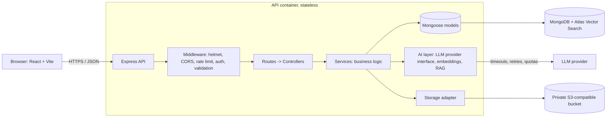

# PrepAI Architecture (Phase 2)

Style: **modular monolith**. One deployable API, strict internal module boundaries, so any module can be extracted later if load justifies it.

## Component diagram

## Modules (server/src)
| Module | Responsibility |
|---|---|
| auth, users | Registration, login, token rotation, RBAC, profile, account deletion |
| resumes | Upload validation, text extraction, AI analysis, JD matching |
| interviews | Sessions, question flow, structured feedback |
| rag | Ingestion (extract, chunk, embed, index), retrieval, grounded answers with citations |
| dsa | Problem tracking CRUD |
| dashboard | Aggregations and recommendations |
| admin | Study material management, audit log |
| ai | Provider interface, prompt templates, output schemas, quotas |
| platform | Config, logging, error handling, health |

Dependency rule: routes -> controllers -> services -> models/adapters. Services never import Express types.

## Security boundaries
1. **Browser to API:** TLS, explicit CORS, httpOnly + SameSite cookies, rate limits, 100 KB JSON body cap.
2. **API to data stores:** private network only, least-privilege DB user, no public bucket access (signed URLs, short expiry).
3. **API to LLM:** server-side keys only, per-user quotas, token caps, outputs schema-validated. Retrieved text is untrusted data and is never placed in the system role.
4. **Admin surface:** server-enforced role check plus audit events.

## Key data flows
- **Resume analysis:** upload -> validate type/size -> private storage -> async job -> extract -> LLM -> schema-validate -> save -> poll status.
- **RAG question:** question -> embed -> vector search (admin-approved corpus only) -> relevance threshold -> grounded prompt -> answer with citations, or "insufficient evidence".

## Technology decisions
| Decision | Choice | Why |
|---|---|---|
| Vector store | MongoDB Atlas Vector Search | One datastore, less to operate |
| Queue | Mongo-backed job collection | Redis deferred until load requires it |
| Validation | Zod | Same schemas for requests and LLM outputs |
| Logging | Pino with redaction | Structured, fast, request IDs |
| Auth | Short-lived access token plus rotating refresh token in httpOnly cookie | Limits token theft impact |
